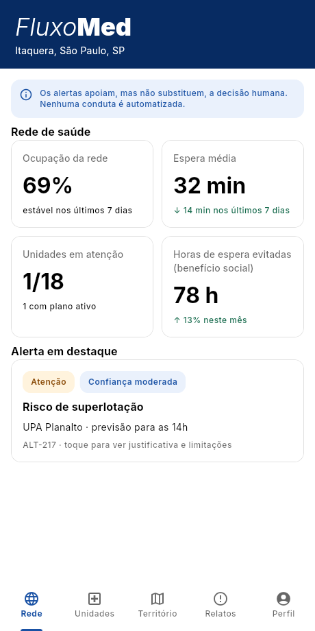
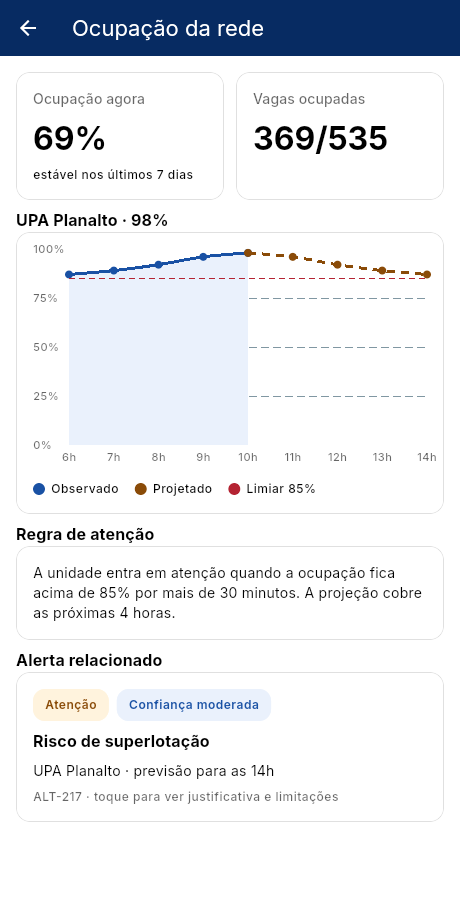
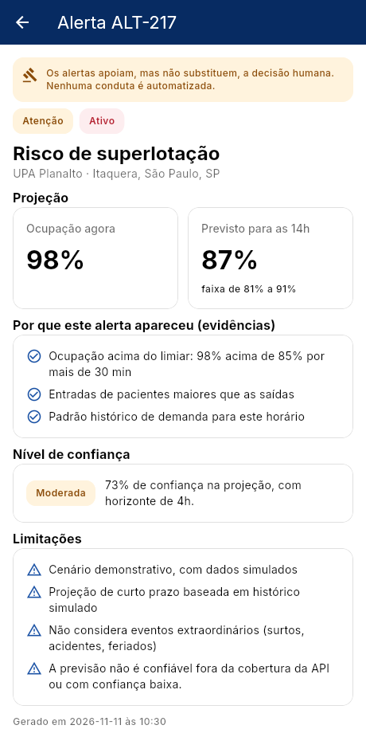
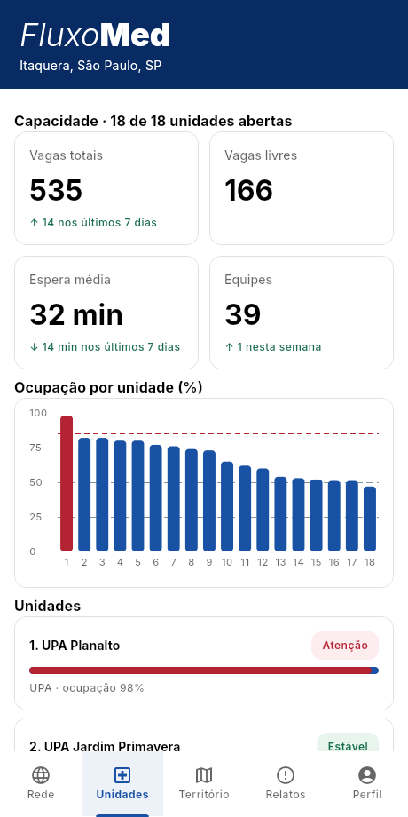
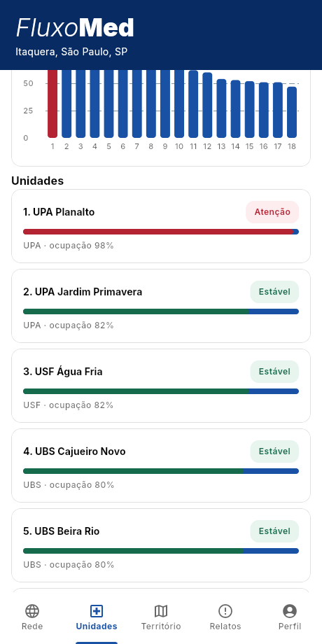
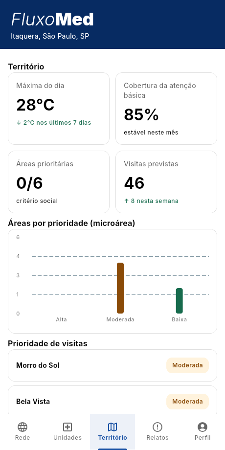
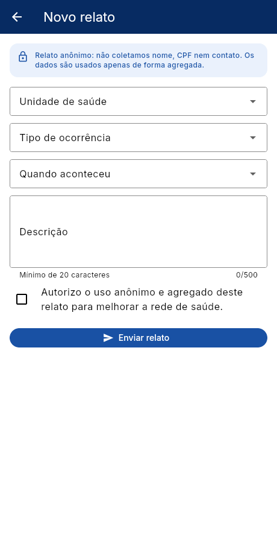
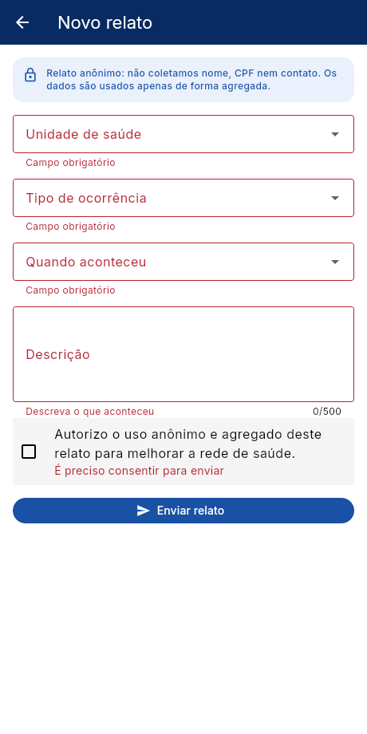
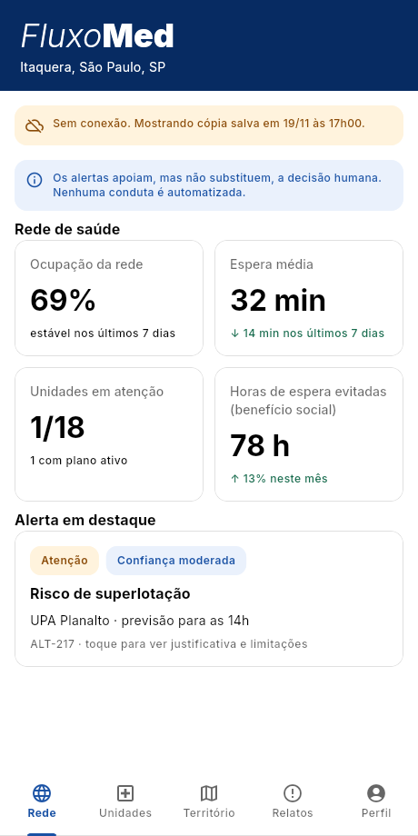
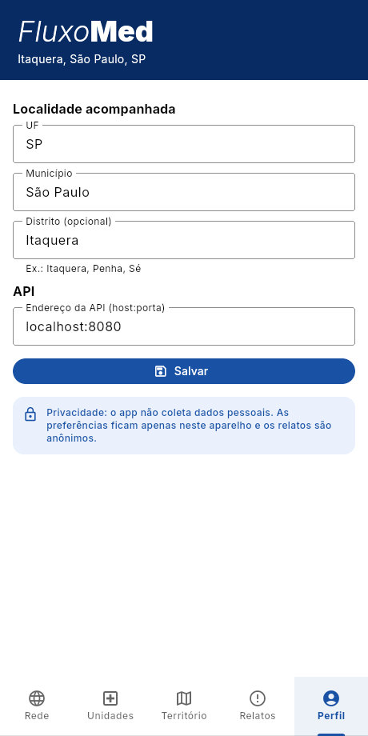

# FluxoMed

**Painel territorial da rede de saúde: antecipa a superlotação de unidades e apoia a decisão humana da equipe de regulação.**

## Problema e público

UPAs e UBSs lotam em horários previsíveis, mas a equipe só percebe quando a fila já existe. O FluxoMed mostra ocupação, espera, clima e cobertura do território e gera alertas de superlotação com 4 h de antecedência, cada um com justificativa, confiança e limitações.

- **Gestor / equipe de regulação**: acompanha os painéis e decide sobre os alertas.
- **Cidadão**: vê a situação das unidades e registra relatos anônimos.
- **Impacto**: menos horas de espera, exibidas como indicador de benefício social.

## Integrantes

| Nome completo              | RM     |
| -------------------------- | ------ |
| Allan de Souza Cardoso     | 561721 |
| Júlia Borges Paschoalinoto | 564725 |

## Demonstração visual

| Rede                                        | Ocupação (detalhe)                              | Alerta (detalhe)                            |
| ------------------------------------------- | ----------------------------------------------- | ------------------------------------------- |
|      |  |  |
| KPIs, benefício social e alerta em destaque | Observado × projetado com limiar                | Evidências, confiança e limitações          |

| Unidades                                        | Lista de unidades                                  | Território                                          |
| ----------------------------------------------- | -------------------------------------------------- | --------------------------------------------------- |
|  |  |  |
| Capacidade e ocupação por unidade               | Status por unidade                                 | Clima, cobertura e prioridades                      |

| Relatos                                       | Formulário                                           | Validação                                             |
| --------------------------------------------- | ---------------------------------------------------- | ----------------------------------------------------- |
|  |  |  |
| Lista de relatos                              | Relato anônimo com consentimento                     | Erros por campo                                       |

| Lista vazia                                       | Offline                                       | Perfil                                      |
| ------------------------------------------------- | --------------------------------------------- | ------------------------------------------- |
|  |  |  |
| Estado vazio                                      | Cópia salva, com data                         | Localidade e API                            |

## Funcionalidades

- [x] 5 abas e 3 rotas nomeadas com parâmetros; fluxo visão geral → indicador → alerta
- [x] 3 dashboards (Rede, Unidades, Território) com KPIs, tendência e gráficos
- [x] Alertas com evidências, nível de confiança, limitações e aviso de decisão humana
- [x] Estado global (localidade e API) compartilhado entre as telas; estado local nos formulários
- [x] Carregamento, erro, sem cobertura e lista vazia tratados; puxar pra atualizar
- [x] API em `./api`, cache local de cada resposta e modo offline
- [x] Formulário de relato com validação e consentimento
- [x] Indicador de benefício social (horas de espera evitadas)
- [x] Rótulos para leitor de tela; testes de validação e do componente de carregamento

## Dados e alertas

- **Fonte**: dados sintéticos gerados por `api/api.py` com seed fixa por localidade. Cobertura: município de São Paulo e seus 32 distritos.
- **Alertas**: regra sobre a projeção de ocupação da UPA mais cheia; surgem acima de 85 % por mais de 30 min e se resolvem quando a ocupação cai.
- **Métricas**: ocupação, espera média, unidades em atenção, vagas, equipes, máxima do dia, cobertura, visitas previstas, horas de espera evitadas.
- **Confiança**: valor 0–1 e nível alta/moderada/baixa em cada alerta.
- **Limitações**: cenário simulado; projeção de curto prazo; não considera eventos extraordinários. Não confiável fora da cobertura, com confiança baixa ou com cópia offline antiga.
- **Decisão humana**: o app não executa ação alguma; o aviso aparece na tela inicial e em cada alerta.

## Privacidade e inclusão

- Relatos anônimos (sem nome, CPF ou contato) com consentimento explícito.
- Preferências ficam só no aparelho.
- Rótulos `Semantics` em cards, gráficos e barras de progresso; respeita o tamanho de fonte do sistema.

## Tecnologias e decisões técnicas

| Escolha                       | Por quê                                                                     |
| ----------------------------- | --------------------------------------------------------------------------- |
| Riverpod                      | Estado global tipado e reativo;                                             |
| Rotas nomeadas                | Suficiente para o fluxo, sem dependência extra                              |
| `http` + `shared_preferences` | Cliente simples com cache para modo offline                                 |
| `fl_chart`                    | Gráficos de linha e barras                                                  |
| FastAPI                       | API mock determinística; só devolve códigos, traduzidos em `lib/texts.dart` |

Estrutura: `lib/models`, `lib/services` (API + cache), `lib/providers`, `lib/components`, `lib/screens/<screen>`. Identificadores em inglês; textos de interface em português.

## Como executar

```sh
# API (Python 3.14+)
cd api
pip install -r requirements.txt
FLUXOMED_FROZEN=1 uvicorn api:app --host 0.0.0.0 --port 8080

# App (Flutter 3.47+)
flutter pub get
flutter run
```

Sem variáveis de ambiente nem chaves. O endereço da API (padrão `localhost:8080`) muda na aba **Perfil**; em um celular, use o IP da máquina. `FLUXOMED_FROZEN=1` mantém o alerta de demonstração sempre ativo.

## Vídeo

_link do vídeo_

## Licença

Projeto acadêmico — FIAP, Global Solution 2026.2.
